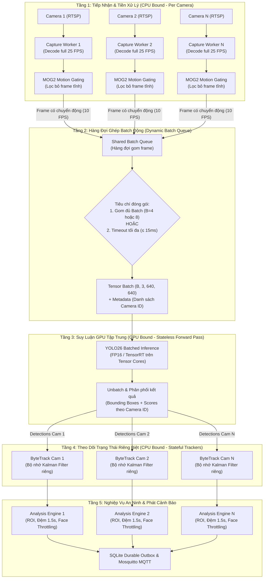

# Kiến Trúc P3: Suy Luận Dùng Chung Giữa Các Camera & Mở Rộng Ngang
## (Shared Inference & Horizontal Scaling Architecture Blueprint)

> **Tài liệu thiết kế đón đầu (Blueprint):** Dành cho giai đoạn nâng cấp và chuyển giao hệ thống lên hạ tầng Máy chủ Cloud / Data Center (GPU Server: NVIDIA T4 / A10 / A100 / L4 / RTX 4090).

---

## 1. Tầm Nhìn & Mục Đích Kiến Trúc

### 1.1 Hiện trạng Kiến trúc Hiện tại (Giai đoạn Demo / Biên)
- **Mô hình Pipeline Độc lập:** Mỗi camera sở hữu một luồng riêng (`CameraStreamWorker` $\to$ `VideoPipeline` $\to$ `YOLO` $\to$ `ByteTrack`).
- **Ưu điểm:** Đơn giản, cô lập lỗi tuyệt đối, tối ưu rất tốt cho cụm 1 – 4 camera nhờ Motion-Gating IDLE, Throttling 0.4s/1.0s, Lazy Overlay, và Shared Face Cache.
- **Giới hạn khi mở rộng lớn (16 – 64+ camera):** 
  - Mỗi frame gửi riêng lẻ lên GPU với `Batch Size = 1` làm phát sinh hiện tượng nghẽn Kernel Launch Overhead, chỉ khai thác được 15% – 25% năng lực của các dòng GPU cao cấp có Tensor Cores.
  - Tranh chấp Python GIL (Global Interpreter Lock) khi nhiều luồng tiền xử lý ảnh trong cùng một tiến trình.

### 1.2 Mục tiêu của Kiến trúc P3
- Tăng mật độ camera xử lý trên 1 GPU từ **4 camera lên 16 – 24 camera đồng thời** (giảm 75% chi phí thuê máy chủ Cloud GPU).
- Đảm bảo độ trễ thời gian thực toàn trình (End-to-End Latency $\le 500\text{ms}$) theo chuẩn NFR-01.
- Bảo toàn 100% tính chính xác của các quy tắc an ninh (không trộn lẫn danh tính, không nhảy Track ID giữa các camera).

---

## 2. Sơ Đồ Kiến Trúc Hệ Thống (Architectural Flow)

---

## 3. Ba Trụ Cột Kỹ Thuật Chi Tiết

### 3.1 Trụ cột 1: Tách Rời Tuyệt Đối Suy Luận (Stateless) & Theo Dõi (Stateful)
- **Bản chất vấn đề:** 
  - Qua thực nghiệm kiểm chứng lỗi **OPT-01**, Ultralytics lưu trữ trạng thái của thuật toán ByteTrack (bộ lọc Kalman và bộ đệm số frame mất dấu) trực tiếp bên trong `model.predictor.trackers`.
  - Nếu chia sẻ cùng một instance `model.track()` cho nhiều camera, track ID của Camera 1 và Camera 2 sẽ bị trộn lẫn, gây sai lệch quỹ đạo và làm sai lệch logic cảnh báo người lạ 1.5s.
- **Giải pháp P3:**
  - **Tầng GPU (Stateless):** Chỉ thực hiện suy luận thuần túy (`model.predict(batch_tensor, half=True)` hoặc TensorRT Engine). Đầu vào là mảng ảnh, đầu ra là danh sách Bounding Boxes và Confidence Score. Tầng này hoàn toàn phi trạng thái, dùng chung an toàn giữa 100% camera.
  - **Tầng Tracker (Stateful):** Mỗi camera sở hữu một instance `ByteTrack` độc lập trên CPU. Tầng này nhận detections từ GPU, thực hiện gán ID, cập nhật ma trận Kalman. Tốn $< 1\text{MB}$ RAM và $< 0.2\text{ms}$ CPU cho mỗi camera.

### 3.2 Trụ cột 2: Ghép Batch Động (Dynamic Batching Engine)
- Thay vì gửi frame đơn lẻ lên GPU, bộ lập lịch vi mô (Micro-Batch Scheduler) thu thập frame từ các camera trong một cửa sổ thời gian cực ngắn:
  $$\text{Timeout Chờ Tối Đa} \le 12\text{ms} - 15\text{ms}$$
- **Quy tắc kích hoạt suy luận:**
  1. Nếu gom đủ kích thước Batch mục tiêu ($B = 4$ hoặc $B = 8$) $\to$ Gửi ngay vào GPU.
  2. Nếu chưa đủ $B$ nhưng đã hết $15\text{ms}$ timeout $\to$ Vẫn gửi ngay số frame hiện có vào GPU để đảm bảo độ trễ thời gian thực.
- **Hiệu quả toán học:**
  - Với Batch = 1: 8 frames xử lý tuần tự mất $8 \times 12\text{ms} = \mathbf{96\text{ms}}$.
  - Với Batch = 8 trên Tensor Cores: 8 frames xử lý đồng thời chỉ mất $\approx \mathbf{20\text{ms}}$ (nhanh hơn **4.8 lần**).

### 3.3 Trụ cột 3: Đa Tiến Trình & Tách Biệt GPU Server (Scale-out)
Nhằm triệt tiêu hoàn toàn nghẽn cổ chai Python GIL:
- **Phương án A (Tự quản lý qua Multi-Process & Shared Memory):**
  - Tách các Ingestion Workers (giải mã RTSP, chạy MOG2) thành các tiến trình Python riêng biệt (`multiprocessing`).
  - Sử dụng bộ nhớ dùng chung (**Shared Memory - POSIX `shm`**) để chuyển frame ảnh thô sang Inference Process mà không tốn chi phí copy dữ liệu qua socket.
- **Phương án B (Tiêu chuẩn Doanh nghiệp: NVIDIA Triton Inference Server):**
  - Toàn bộ mô hình YOLO26 và ArcFace được biên dịch sang TensorRT (`.plan`).
  - Triển khai riêng một container **NVIDIA Triton Inference Server**. Triton tự động tối ưu Dynamic Batching ở tầng C++, cấp phát VRAM tối ưu và hỗ trợ chia tải tự động trên nhiều GPU (`GPU 0`, `GPU 1`,...).
  - AI Service của chúng ta chỉ đóng vai trò Gateway gửi frame qua gRPC nội bộ tốc độ cao ($< 1\text{ms}$).

---

## 4. Bảng Đánh Giá Điều Kiện Ngưỡng Kích Hoạt (Cost-Benefit Threshold)

| Tiêu chí | Trạng thái Hiện tại (Nên Giữ Nguyên) | Khi Nào Bắt Buộc Nâng Cấp Lên P3? |
| :--- | :--- | :--- |
| **Quy mô Camera** | **1 – 4 Camera** (Đồ án, demo, phòng lab) | **8 – 32+ Camera** (Triển khai toàn trường/tòa nhà) |
| **Phần cứng Host** | CPU hoặc GPU phổ thông (GTX 1650, 1050) | GPU Server có Tensor Cores (NVIDIA T4, A10, L4, RTX 4090) |
| **Tài nguyên Tiêu thụ** | CPU: ~20-25%, VRAM: ~1.2GB (đã rất tối ưu) | CPU/VRAM chạm ngưỡng bão hòa nếu chạy kiến trúc cũ với 16 cam |
| **Độ phức tạp Vận hành** | Thấp: Chạy gọn trong 1 service, dễ debug | Cao: Cần quản lý hàng đợi IPC, Triton Server, monitoring đa GPU |
| **Khuyến nghị** | **GIỮ VỮNG KIẾN TRÚC HIỆN TẠI** | **KÍCH HOẠT NÂNG CẤP LÊN P3** |

---

## 5. Lộ Trình Nâng Cấp Từng Bước (Upgrade Roadmap)

Khi hệ thống được bàn giao lên máy chủ Cloud/Data Center, quá trình nâng cấp theo kiến trúc P3 sẽ thực hiện theo 4 bước tuần tự mà không làm gián đoạn nghiệp vụ an ninh:

1. **Bước 1: Tách Stateless YOLO Wrapper**
   - Chuyển `HumanDetector.model.track()` thành `HumanDetector.model.predict()` (nhận tensor batch).
   - Tách instance `ByteTrack` ra khỏi `HumanDetector`, đặt trực tiếp vào từng `CameraStreamWorker`.
2. **Bước 2: Xây dựng Dynamic Batch Queue**
   - Viết `BatchInferenceQueue` sử dụng `asyncio.Queue` hoặc `multiprocessing.Queue` với timeout $15\text{ms}$.
   - Đo đạc độ trễ và thông lượng trên GPU máy chủ với các kích thước batch khác nhau ($B=2, 4, 8$).
3. **Bước 3: Tối ưu Hóa TensorRT & FP16**
   - Export mô hình YOLO26 sang định dạng TensorRT Engine (`yolo26n.engine`) trên chính GPU của máy chủ đích.
   - Bật cấu hình `AI_HALF=true` để kích hoạt Tensor Cores.
4. **Bước 4: Tách Service nếu quy mô $\ge 32$ Camera**
   - Đóng gói container Triton Inference Server độc lập nếu hệ thống mở rộng lên hàng chục camera trên nhiều card đồ họa.
