# Access control diagrams (Mermaid)

Diagrams for the access-control modules (access requests, guest visits, assigned personnel, areas, event schedules, entry decision), kept as Mermaid source so they can be reviewed and versioned with the code.

- Drawn from the code on `main` @ `84f5565` (migrations up to V89). **Updated 2026-10-25** against `main` @ `84c7760` for the access-rules changes (no review after start time, system finish of elapsed requests, one assigned-personnel record per grant, event mode opened by schedules only): SM-01, SM-03, SM-04, AD-01, AD-03, SQ-02 and CD-01 part 2. **Checked 2026-10-29** against `main` @ `e474968`: SM-01 … SM-05 unchanged; SM-06 (user account) added. Where code and documents disagree, the diagram follows the code; the differences are listed in [Differences from the documents](#differences-from-the-documents).
- Every `.mmd` file starts with `%% Title: … · Source: … · Generated from main @ <commit>`.
- SM-01 … SM-06 also have a PlantUML version (`state-*.puml`, same name) used in the SDD (Report 4 §4). Edit the `.mmd` and the `.puml` together.
- Paths in the tables are relative to `backend/src/main/java/com/fa26se040/icss/` unless they start with `frontend/`, `ai-service/` or `db/`.

## How to view

- **GitHub:** this README embeds every diagram in a ```` ```mermaid ```` block (section [Diagrams](#diagrams)); GitHub renders them. The `.mmd` files themselves are shown as plain text on GitHub.
- **VS Code:** open a `.mmd` file with a Mermaid preview extension, or preview this README.
- **SVG / PNG:** `npx -p @mermaid-js/mermaid-cli mmdc -i state-access-request.mmd -o state-access-request.svg` (run outside the repo; do not commit images).
- **Printing:** all diagrams fit A4. `seq-check-entry` (11 lifelines), `erd-access-control` and `activity-guest-visit` read best in landscape.

## Actors and names used in every diagram

| Name in diagrams | Code |
|---|---|
| Authorized User | role `NORMAL_USER` |
| Facility Manager | role `FACILITY_MANAGER` |
| Administrator | role `ADMIN` |
| Host | `NORMAL_USER` or `FACILITY_MANAGER` that creates a guest visit (`GuestRules.HOST_ROLES`) |
| AI Surveillance Engine | `ai-service` (calls `POST /api/access-control/check-entry`, extracts guest embeddings) |
| System (job) / System (backend and jobs) | `@Scheduled` jobs and backend checks |
| Access Requests Page | `frontend/src/pages/accessRequest/AccessRequestPage.jsx` (`/access-requests`) |
| Request Approval Page (tab Access requests / Guest visits) | `frontend/src/pages/approvals/ApprovalPage.jsx` (`/admin/access-requests?tab=requests\|guests`) |
| My Guest Visits Page | `frontend/src/pages/guestVisit/GuestVisitPage.jsx` (`/guest-visits`) |
| Guest Photos Page | `frontend/src/pages/guestVisit/GuestPhotoPage.jsx` (`/admin/guest-photos`) |
| Event Management Page | `frontend/src/pages/events/EventManagementPage.jsx` (`/admin/events`) |

## Diagram index

| Code | File | Type | Entity / workflow | Main code source (file: function) | Note |
|---|---|---|---|---|---|
| CTX-01 | `context-diagram.mmd` (+ `context-diagram.svg` for reports) | flowchart (ELK layout) | Whole system, level 0 | `controller/*` (`@PreAuthorize` roles), `security/GoogleTokenVerifier.java`, `service/NotificationService.java`, `service/CameraConnectionService.java`, `MediaMtxService.java`, `mobile/lib` | System = circle, external entities = rectangles, flows = nouns |
| SM-01 | `state-access-request.mmd` | stateDiagram-v2 | Access request | `enums/RequestStatus.java`, `service/AccessRequestService.java`, `service/AreaService.java: cancelRequestsBySystem` | System job finishes elapsed APPROVED requests (D5 resolved) |
| SM-02 | `state-guest-visit.mmd` | stateDiagram-v2 | Guest visit | `enums/GuestVisitStatus.java`, `service/GuestVisitService.java`, `service/GuestVisitJobService.java` | Biometric deletion is a note (it is `Guest.biometricStatus`) |
| SM-03 | `state-event-schedule.mmd` | stateDiagram-v2 | Event schedule | `enums/AreaEventScheduleStatus.java`, `service/AreaService.java` | |
| SM-04 | `state-assigned-personnel.mmd` | stateDiagram-v2 | Assigned personnel | `service/AreaAssignedPersonnelService.java: computeStatus` | Status computed, not stored. EXPIRED is final; no validity edit (D7 resolved) |
| SM-05 | `state-area.mmd` | stateDiagram-v2 | Area | `entity/Area.java`, `service/AreaService.java: create, update, deactivate, restore` | Business states, no status enum |
| SM-06 | `state-user.mmd` | stateDiagram-v2 | User account | `entity/User.java`, `service/UserService.java: createStaffAccount, toggleActive, softDelete, deleteBatch, restoreBatch` | Business states, no status enum. Only import batches can be restored |
| AD-01 | `activity-access-request.mmd` | flowchart, swimlanes | Request access workflow | `AccessRequestService`, `AccessDecisionService` | |
| AD-02 | `activity-guest-visit.mmd` | flowchart, swimlanes | Guest visit workflow | `GuestVisitService`, `GuestPhotoService.attach`, `GuestVisitJobService`, `GuestAccessDecisionService` | |
| AD-03 | `activity-event-schedule.mmd` | flowchart, swimlanes | Event schedule workflow | `AreaService`, `scheduler/AreaEventModeScheduler.java` | |
| SQ-01 | `seq-create-access-request.mmd` | sequenceDiagram | Create access request (individual) | `AccessRequestController.createIndividualRequest` → `AccessRequestService.createIndividualRequest` | Group path in a note |
| SQ-02 | `seq-review-access-request.mmd` | sequenceDiagram | Approve / reject request | `AccessRequestService.reviewRequest`, `AccessRequestRepository.reviewIfPending` | Non-PENDING gives 409, not 400 (D6) |
| SQ-03 | `seq-finish-access-request.mmd` | sequenceDiagram | Finish request | `AccessRequestService.finishRequest`, `AccessRequestRepository.finishIfApprovedStarted` | |
| SQ-04 | `seq-check-entry.mmd` | sequenceDiagram | Entry decision | `AccessControlController.checkCameraEntry` → `AccessDecisionService.checkCameraEntry, checkEntry` | Guest branch is wired (D1) |
| SQ-05 | `seq-create-event-schedule.mmd` | sequenceDiagram | Create event schedule | `AreaController.createEventSchedule` → `AreaService.createSchedule` | |
| SQ-06 | `seq-guest-visit-review.mmd` | sequenceDiagram | Review guest visit | `GuestVisitController.review` → `GuestVisitService.review` | |
| CD-01 | `class-access-control.mmd` + `class-access-control-services.mmd` | classDiagram | Part 1 domain model, part 2 controllers / services / jobs | `entity/*`, `enums/*`, `controller/*`, `service/*`, `scheduler/*` | Split: more than 25 classes (Q-07) |
| ER-01 | `erd-access-control.mmd` | erDiagram | Access-control tables | `db/migration` V19 … V89 | Actor FKs drawn as columns only (see ER-01 note) |

## Traceability of state machines

### SM-01 Access request

| State / transition | Source |
|---|---|
| States | `enums/RequestStatus.java` (DB CHECK `chk_access_requests_status`, V40) |
| [*] → PENDING (Authorized User) | `AccessRequestService.createIndividualRequest`, `createGroupRequest` (`status(RequestStatus.PENDING)`); `AccessRequestController` `@PreAuthorize("hasRole('NORMAL_USER')")` |
| PENDING → APPROVED / REJECTED (Facility Manager, before startTime) | `AccessRequestService.reviewRequest` (early check `hasStarted` → `ERR_AC_012`) → `AccessRequestRepository.reviewIfPending` (`… AND startTime > :reviewedAt`) |
| PENDING → CANCELLED, source USER (requester) | `AccessRequestService.cancelRequest` → `cancelIfPending`, `recordCancellation(…, CancelSource.USER, …)` |
| PENDING → EXPIRED (job, every 15 min) | `AccessRequestService.expireOverdueRequests` (`@Scheduled icss.scheduler.expire-overdue-cron`) → `findPendingOverdueRequestsForUpdate` (`startTime < now`), `expireOverdueRequestsByIds` |
| PENDING → CANCELLED, source SYSTEM | `AreaService.update` → `evaluateTypeChange` (new type PUBLIC, `PUBLIC_CANCEL_REASON`) → `cancelRequestsBySystem`; `AreaService.deactivate` → `AreaDependencyChecker.evaluate` → `cancelRequestsBySystem`; `AccessRequestService.cancelActiveRequestsOfRequester` ← `UserService.toggleActive`, `softDelete`, `deleteBatch`; all via `AccessRequestRepository.cancelBySystemIfStatus` |
| APPROVED → FINISHED (Facility Manager) | `AccessRequestService.finishRequest` → `finishIfApprovedStarted` (`startTime <= now`) |
| APPROVED → FINISHED (system job, every 15 min) | `AccessRequestService.finishElapsedApprovedRequests` (`@Scheduled icss.scheduler.finish-elapsed-cron`) → `AccessRequestRepository.findApprovedElapsedRequestsForUpdate` (`endTime <= now`), `finishElapsedRequestsByIds` (`finishedBy = NULL`, `FINISH_REASON_ELAPSED`) |
| APPROVED → CANCELLED, source STAFF (Facility Manager) | `AccessRequestService.cancelApprovedRequest` → `cancelIfApprovedNotStarted` (`startTime > now`), `recordCancellation(…, CancelSource.STAFF, …)` |
| APPROVED → CANCELLED, source SYSTEM | `AreaService.evaluateTypeChange` + `describeRuleViolation` → `cancelRequestsBySystem`; `AreaService.deactivate`; `AccessRequestService.cancelActiveRequestsOfRequester` (`findNotEndedByRequesterWithParticipants`, `endTime > now`) |
| Note: entry window | `AccessDecisionService.checkEntry` → `findCoveringRequestsForUser` (`startTime <= at < endTime`) |

### SM-02 Guest visit

| State / transition | Source |
|---|---|
| States | `enums/GuestVisitStatus.java` (DB CHECK `chk_guest_visits_status`, V60) |
| [*] → PENDING (Host) | `GuestVisitService.create` |
| PENDING → APPROVED / REJECTED (Facility Manager) | `GuestVisitService.review`, `recheckForApproval` |
| PENDING / APPROVED → CANCELLED (Host) | `GuestVisitService.cancel` (`deleteAllBiometrics` when the visit was APPROVED) |
| PENDING → CANCELLED (Administrator deactivates area) | `AreaService.deactivate` → `GuestVisitService.closeForAreaDeactivation` (PENDING branch) |
| APPROVED → REVOKED (Facility Manager) | `GuestVisitService.revoke` → `applyRevoke` |
| APPROVED → REVOKED (Administrator deactivates area) | `GuestVisitService.closeForAreaDeactivation` → `applyRevoke` |
| PENDING → EXPIRED (job) | `scheduler/GuestVisitScheduler.tick` → `GuestVisitJobService.runAll` → `expirePendingVisits` |
| APPROVED → COMPLETED (job) | `GuestVisitJobService.completeApprovedVisits` |
| Note: biometrics | `GuestPhotoService.attach` (PHOTO_READY), `GuestBiometricService.deleteBiometrics` (DELETED), `GuestVisitJobService.deleteDueBiometrics`, `anonymizeGuests`; `enums/GuestBiometricStatus.java` |

### SM-03 Event schedule

| State / transition | Source |
|---|---|
| States | `enums/AreaEventScheduleStatus.java` (DB CHECK `chk_area_event_schedules_status`, V56) |
| [*] → SCHEDULED (Facility Manager) | `AreaService.createSchedule` |
| SCHEDULED → SCHEDULED (edit) | `AreaService.updateSchedule` (requires SCHEDULED, ERR_AREA_040) |
| SCHEDULED → CANCELLED | `AreaService.cancelSchedule` |
| SCHEDULED → STARTED / FAILED (job) | `scheduler/AreaEventModeScheduler.tick` → `AreaService.processScheduledEventActivations` → `activateScheduleInTx` |
| Manual ENABLE / ADJUST removed | `AreaService.updateEventMode`: any action other than DISABLE → `ERR_AREA_058` |
| STARTED → COMPLETED | `AreaService.cleanupExpiredSessions` → `finishScheduleOfSession(…, COMPLETED)`; called by `processExpiredEventSessions` / `expireEventSessionForAreaInTx` and by `updateEventMode`, `createSchedule`, `updateSchedule`, `cancelSchedule`, `activateScheduleInTx` |
| STARTED → ENDED_EARLY (Facility Manager stops) | `AreaService.updateEventMode` (DISABLE branch) → `finishScheduleOfSession(…, ENDED_EARLY)` |

### SM-04 Assigned personnel

| State / transition | Source |
|---|---|
| States (computed) | `enums/AssignedPersonnelStatus.java`, `AreaAssignedPersonnelService.computeStatus`; stored columns `valid_from`, `valid_to`, `revoked_at` (V37) |
| [*] → UPCOMING / ACTIVE | `AreaAssignedPersonnelService.create` (`validFrom` defaults to now) |
| UPCOMING → ACTIVE, ACTIVE → EXPIRED (time) | `AreaAssignedPersonnelService.computeStatus` |
| No validity edit | `AreaAssignedPersonnelController` has no update endpoint; `AssignedPersonnelUpdateRequest` removed. `create` rejects `validFrom` older than `now − VALID_FROM_CLOCK_SKEW` (5 min) → `ERR_AP_013` |
| UPCOMING / ACTIVE → REVOKED (Facility Manager) | `AreaAssignedPersonnelService.revoke` (already revoked → `ERR_AP_009`; EXPIRED → `ERR_AP_012`) |
| UPCOMING / ACTIVE → REVOKED (account deactivated / deleted) | `UserService.toggleActive`, `softDelete`, `deleteBatch` → `AreaAssignedPersonnelService.revokeAllOfUser` (`findNotRevokedNotExpiredByUser`) |
| UPCOMING / ACTIVE → REVOKED (area deactivated) | `AreaService.deactivate` → `revokeAssignedPersonnelOnDeactivation` (`AreaDependencyChecker.evaluate` → `findNotRevokedNotExpired`) |

### SM-05 Area

| State / transition | Source |
|---|---|
| In operation / Deactivated | `entity/Area.java` (`isActive`, `deletedAt`); only `AreaService.deactivate` and `restore` write them |
| PUBLIC / CONFIDENTIAL / HIGHLY_CONFIDENTIAL | `enums/AreaLevel.java` (V83) |
| [*] → In operation | `AreaService.create` |
| Type change (6 transitions) | `AreaService.update` → `evaluateTypeChange` blockers: ERR_AREA_048 (active event, new type not Confidential), ERR_AREA_042 (SCHEDULED schedules), ERR_AREA_049 (to PUBLIC with active AP) |
| In operation → Deactivated | `AreaService.deactivate`, `AreaDependencyChecker.evaluate` (ERR_AREA_009, 051, 052, 042) |
| Deactivated → In operation | `AreaService.restore` (ERR_AREA_054, 055, 020) |
| Deactivated area cannot be edited | `AreaService.update` (`filter(a -> a.getDeletedAt() == null)` → ERR_AREA_002) |

### SM-06 User account

| State / transition | Source |
|---|---|
| ACTIVE / DEACTIVATED / DELETED | `entity/User.java` (`isActive`, `deletedAt`, `importBatchId`) |
| [*] → ACTIVE (create) | `UserService.createStaffAccount` (ADMIN role refused), mail via `sendAccountSetupEmailAfterCommit` |
| [*] → ACTIVE (import) | `UserBulkImportHelper` (face data via `FaceDataService.registerFace`, mail after the row commits) |
| ACTIVE ↔ DEACTIVATED | `UserService.toggleActive` (not own account); deactivation calls `cancelActiveRequestsOfRequester`, `revokeAllOfUser`, `closeWebSocketSessionsAfterCommit` |
| → DELETED (one account) | `UserService.softDelete` (not own account, same side effects) |
| → DELETED (batch) | `UserService.deleteBatch` → `UserRepository.softDeleteByImportBatchId` |
| DELETED → ACTIVE | `UserService.restoreBatch` (skips accounts whose code or e-mail is used by a live account) |
| Login refused | `AuthService` (`findByEmailAndIsActiveTrue`), `security/JwtAuthenticationFilter.java` |
| Hosted guest visits | Status unchanged; `GuestAccessDecisionService` denies entry with `HOST_LOST_ACCESS` |

## ER-01 note

Columns that only record who acted (`reviewer_id` is drawn, but `cancelled_by`, `finished_by`, `created_by`, `revoked_by`, `started_by`, `ended_by`, `reviewed_by`, `consent_confirmed_by`, `changed_by`) are FKs to `users.id` listed as `FK` columns without a relationship line, so the diagram stays readable on A4. `floors.building_id` → `buildings` is outside the module and not drawn. `area_event_sessions.schedule_id` (V56) and `area_event_schedules.session_id` (V55_1) are both real FKs.

## Differences from the documents

The diagrams follow the code. Differences found with `r3-draft` (II-5-1 business rules, II-3-1-2 screens, II-2-1 actors):

| # | Document says | Code does |
|---|---|---|
| D1 | II-5-1 §6 intro: guest entry decision "not yet called by any entry flow" | `AccessDecisionService.checkCameraEntry` calls `GuestAccessDecisionService.checkGuestEntry` for guest codes, and `ai-service/src/core/face_matcher.py` loads `guest_face_embeddings` of APPROVED, PHOTO_READY guests. BR-CE-03 in the same draft already says so |
| D2 | BR-GV-04: selectable areas are "Internal Confidential and Contact-Required Confidential" | Since V83 only `CONFIDENTIAL` (`GuestRules.GUEST_AREA_LEVELS`) |
| D3 | BR-GV-27: immediate deletion for CANCELLED / REVOKED / EXPIRED | Also REJECTED (`GuestVisitJobService.CLOSED_WITHOUT_VISIT`) |
| D4 | BR-GV-38 describes a "photo without a valid embedding" status | `PHOTO_ONLY` exists in `GuestBiometricStatus` but no code sets it; `GuestPhotoService.attach` rejects a photo without a valid embedding |
| D5 | (not stated) | Resolved on `84c7760`: the job `finishElapsedApprovedRequests` moves elapsed APPROVED requests to FINISHED |
| D6 | (task brief) review returns 400 for a wrong status | Non-PENDING gives 409 (`ConcurrentReviewException`); 400 only for bad input or failed re-check (matches BR-RQ-40) |
| D7 | BR-AP-08 forbids changes to revoked records only | Resolved on `84c7760`: validity edit removed (one record per grant), and `revoke` refuses EXPIRED records |
| D8 | II-2-1 actors: "AI Service", "System Scheduler", "Guard" | Diagrams use the task names: AI Surveillance Engine, System (job), Security Officer (code `GUARD`) |

## Context diagram notes

| Choice | Reason |
|---|---|
| AI Surveillance Engine, mobile app, MediaMTX, MinIO, Kafka, PostgreSQL are **inside** the system circle | They are built or deployed by the team as part of ICSSS |
| Guest is **not** an external entity | A guest never uses the system; the host registers the visit and the Administrator attaches the photo (decision D1, 06/10) |
| Google Identity Service | The web client gets a Google ID token in the browser; the backend verifies it with `GoogleIdTokenVerifier`, which downloads Google signing certificates |
| Google Drive (dashed) | **Planned, not yet in code** (decision 25/10: archive every 1-minute recording segment to the team's Google Drive; owner Bảo). Shown dashed so the diagram does not claim an implemented integration. Turn it solid when the uploader is merged |
| No push service | The guard app gets alerts over STOMP while running; there is no FCM (`mobile/lib/core/notifications/local_notification_service.dart`) |
| Two files, same content | `context-diagram.mmd` is the Mermaid source (Review 2 requirement). `context-diagram.svg` is a hand-laid version of the **same flows** for reports and slides (users on the left, external systems on the right, one inbound and one outbound arrow per entity). Change both together |

## Diagrams

Embedded copies of the `.mmd` files (the `.mmd` file is the source; keep both in sync).

### CTX-01 Context diagram (level 0)

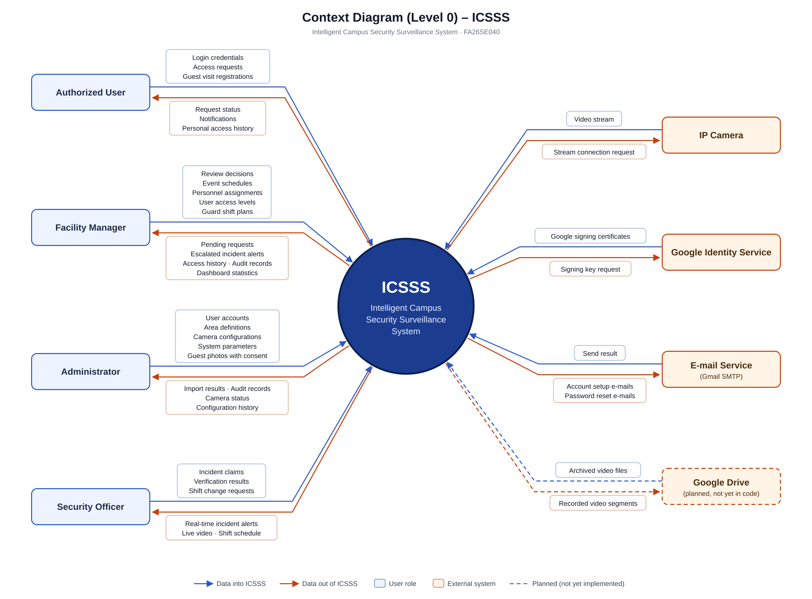

Mermaid source:

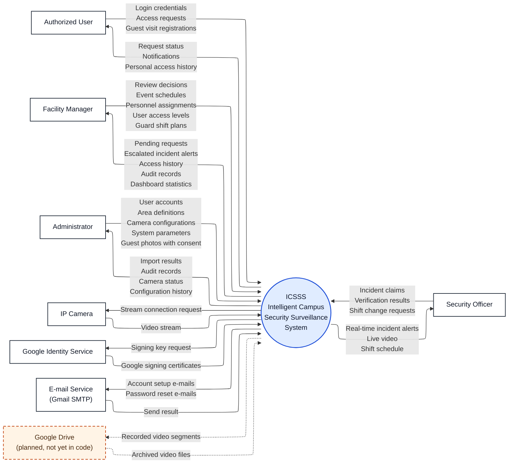

### SM-01 Access request lifecycle

Source file: [`state-access-request.mmd`](state-access-request.mmd)

```mermaid
%% Title: SM-01 Access request lifecycle · Source: enums/RequestStatus.java, service/AccessRequestService.java, service/AreaService.java (cancelRequestsBySystem) · Generated from main @ 84c7760
stateDiagram-v2
    direction LR

    state "PENDING · awaiting review" as PENDING
    state "APPROVED · grants entry inside window" as APPROVED
    state "REJECTED" as REJECTED
    state "CANCELLED" as CANCELLED
    state "EXPIRED" as EXPIRED
    state "FINISHED" as FINISHED

    [*] --> PENDING : Authorized User creates request [area not Public, valid window, no overlap]

    PENDING --> APPROVED : Facility Manager approves [now before startTime, reviewer is not requester, members re-checked, UPDATE WHERE status = PENDING AND startTime > now hits 1 row]
    PENDING --> REJECTED : Facility Manager rejects [now before startTime, reason required, UPDATE WHERE status = PENDING AND startTime > now hits 1 row]
    PENDING --> CANCELLED : Authorized User (requester) cancels [UPDATE WHERE status = PENDING hits 1 row] / source USER
    PENDING --> EXPIRED : System job expireOverdueRequests every 15 min [startTime before now; review after start is refused with ERR_AC_012]
    PENDING --> CANCELLED : System [area changed to Public, area deactivated, or requester deactivated or deleted] / source SYSTEM

    APPROVED --> FINISHED : Facility Manager finishes [now at or after startTime, reason required]
    APPROVED --> FINISHED : System job finishElapsedApprovedRequests every 15 min [endTime at or before now] / finished_by NULL, reason "Hết thời gian hiệu lực", no notification
    APPROVED --> CANCELLED : Facility Manager cancels approved request [now before startTime, reason required] / source STAFF
    APPROVED --> CANCELLED : System [area type change breaks request rule, area deactivated, or requester deactivated or deleted, with endTime after now] / source SYSTEM

    REJECTED --> [*]
    CANCELLED --> [*]
    EXPIRED --> [*]
    FINISHED --> [*]

    note right of APPROVED
        Entry is granted only while
        startTime <= at < endTime (checkEntry).
        After endTime the system job moves it to FINISHED.
    end note
```

### SM-02 Guest visit lifecycle

Source file: [`state-guest-visit.mmd`](state-guest-visit.mmd)

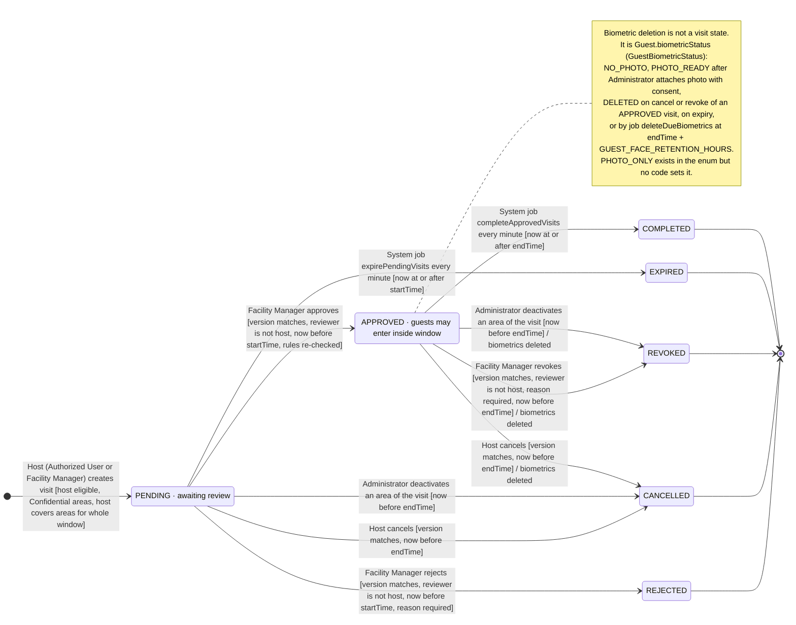

### SM-03 Event schedule lifecycle

Source file: [`state-event-schedule.mmd`](state-event-schedule.mmd)

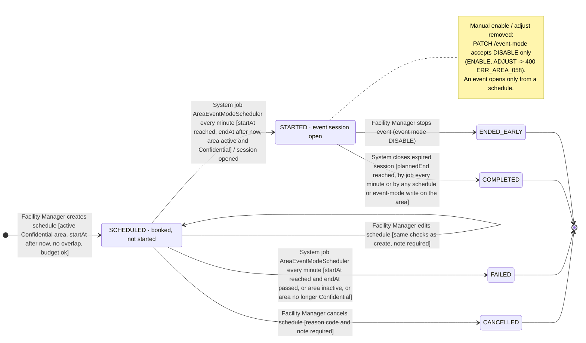

### SM-04 Assigned personnel (AP) status

Source file: [`state-assigned-personnel.mmd`](state-assigned-personnel.mmd)

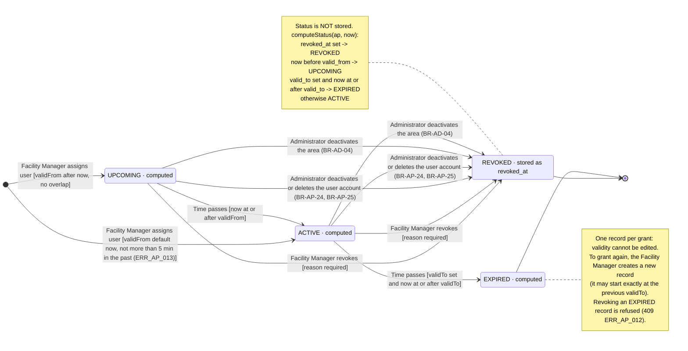

### SM-05 Area lifecycle (active / deactivated, area type)

Source file: [`state-area.mmd`](state-area.mmd)

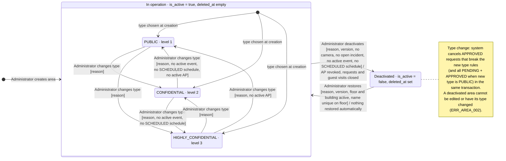

### SM-06 User account lifecycle

Source file: [`state-user.mmd`](state-user.mmd)

```mermaid
%% Title: SM-06 User account lifecycle · Source: entity/User.java (isActive, deletedAt, importBatchId), service/UserService.java (createStaffAccount, bulkImport*, toggleActive, softDelete, deleteBatch, restoreBatch), service/UserBulkImportHelper.java, repository/UserRepository.java (softDeleteByImportBatchId), security/JwtAuthenticationFilter.java, service/AuthService.java · Generated from main @ e474968
stateDiagram-v2
    direction LR

    state "ACTIVE · is_active = true, deleted_at empty" as ACTIVE
    state "DEACTIVATED · is_active = false, deleted_at empty" as DEACTIVATED
    state "DELETED · is_active = false, deleted_at set (soft delete)" as DELETED

    [*] --> ACTIVE : Administrator creates staff account [role FACILITY_MANAGER, GUARD or NORMAL_USER; never ADMIN] / credentials e-mailed after commit
    [*] --> ACTIVE : Administrator imports accounts from file [valid row with face photo] / import_batch_id set, face data registered, credentials e-mailed after the row commits

    ACTIVE --> DEACTIVATED : Administrator deactivates [not own account] / requests PENDING or APPROVED cancelled (source SYSTEM), assigned personnel revoked, WebSocket sessions closed, AI face cache refreshed
    DEACTIVATED --> ACTIVE : Administrator reactivates / nothing restored automatically, AI face cache refreshed

    ACTIVE --> DELETED : Administrator deletes account [not own account] / same side effects as deactivation
    DEACTIVATED --> DELETED : Administrator deletes account [not own account]
    ACTIVE --> DELETED : Administrator removes import batch / same side effects for every account of the batch
    DEACTIVATED --> DELETED : Administrator removes import batch

    DELETED --> ACTIVE : Administrator restores import batch [account belongs to the batch, user code and e-mail not used by another live account] / skipped accounts reported

    note right of DEACTIVATED
        DEACTIVATED and DELETED accounts cannot log in
        (password, Google or reset link: findByEmailAndIsActiveTrue)
        and existing JWTs are refused by JwtAuthenticationFilter.
        Guest visits hosted by the account keep their status;
        guest entry is denied at decision time (HOST_LOST_ACCESS).
    end note

    note left of DELETED
        There is no single-account restore.
        Only accounts created by import (import_batch_id set)
        can return, and they always return as ACTIVE.
    end note
```

### AD-01 Access request workflow

Source file: [`activity-access-request.mmd`](activity-access-request.mmd)

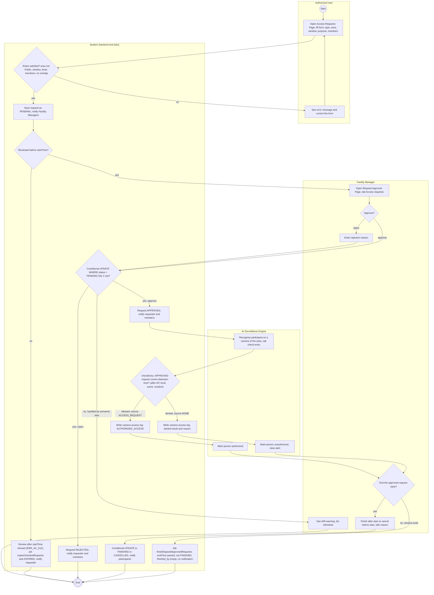

### AD-02 Guest visit workflow

Source file: [`activity-guest-visit.mmd`](activity-guest-visit.mmd)

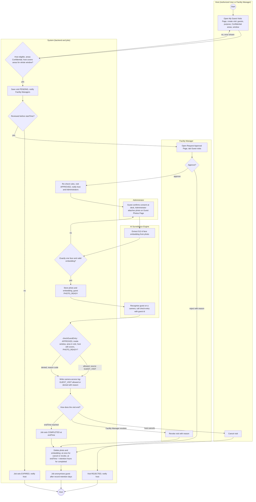

### AD-03 Event schedule workflow

Source file: [`activity-event-schedule.mmd`](activity-event-schedule.mmd)

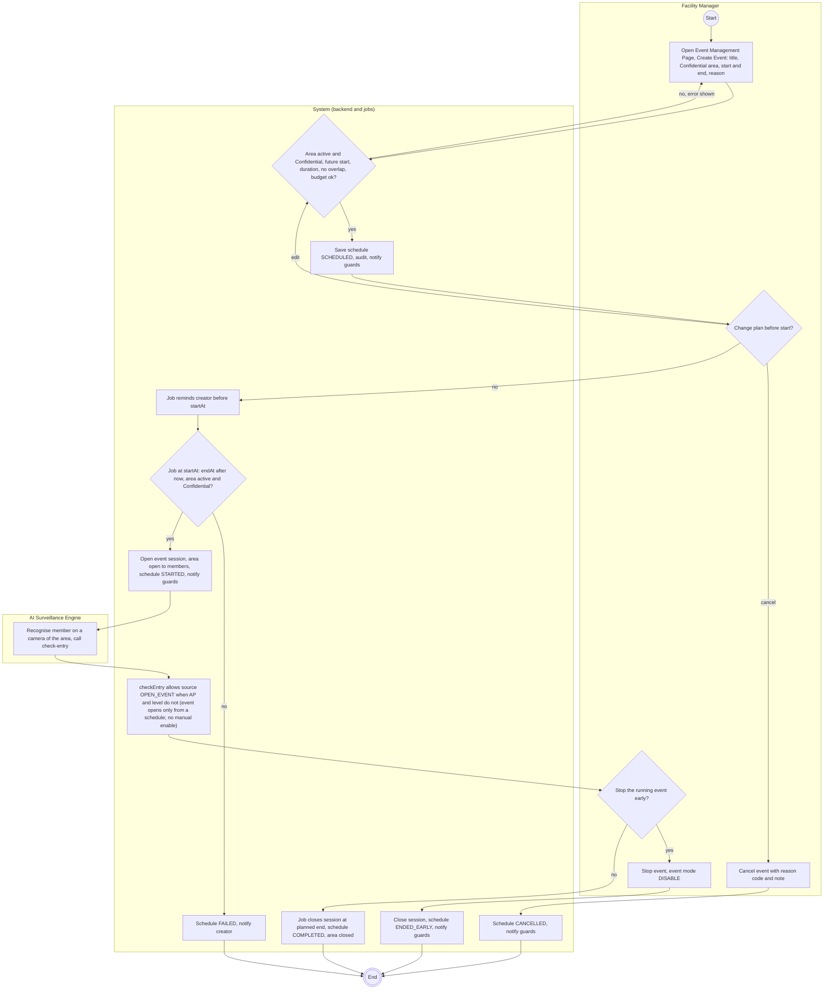

### SQ-01 Create access request (individual)

Source file: [`seq-create-access-request.mmd`](seq-create-access-request.mmd)

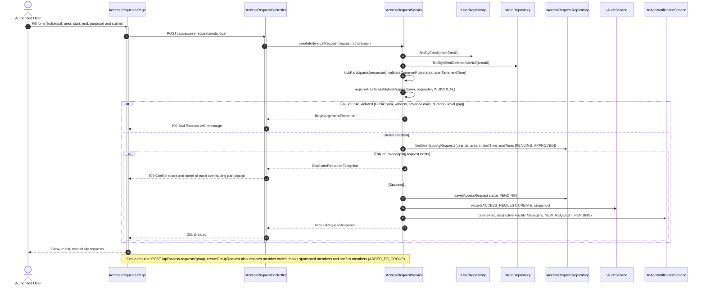

### SQ-02 Review (approve / reject) access request

Source file: [`seq-review-access-request.mmd`](seq-review-access-request.mmd)

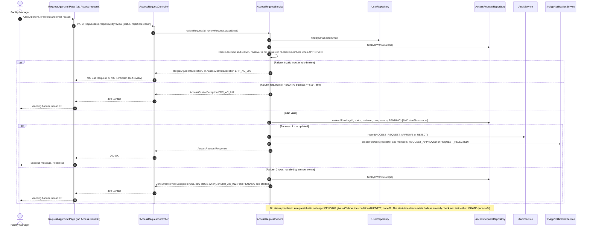

### SQ-03 Finish approved access request

Source file: [`seq-finish-access-request.mmd`](seq-finish-access-request.mmd)

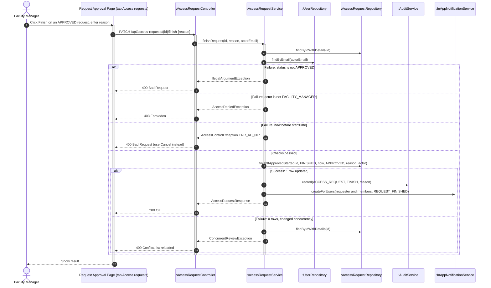

### SQ-04 AI Surveillance Engine calls checkEntry

Source file: [`seq-check-entry.mmd`](seq-check-entry.mmd)

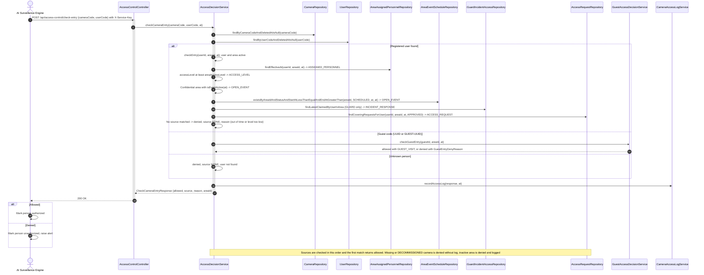

### SQ-05 Create event schedule

Source file: [`seq-create-event-schedule.mmd`](seq-create-event-schedule.mmd)

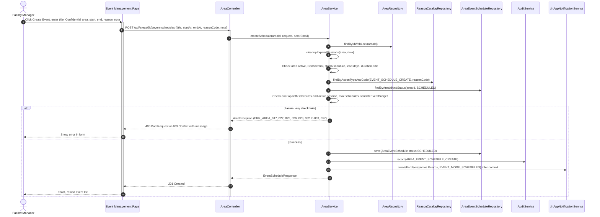

### SQ-06 Review guest visit

Source file: [`seq-guest-visit-review.mmd`](seq-guest-visit-review.mmd)

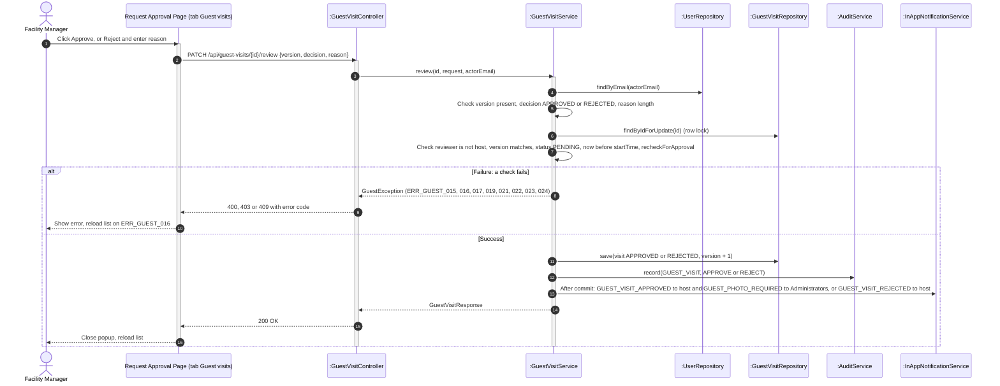

### CD-01 Access control classes, part 1 of 2: domain model

Source file: [`class-access-control.mmd`](class-access-control.mmd)

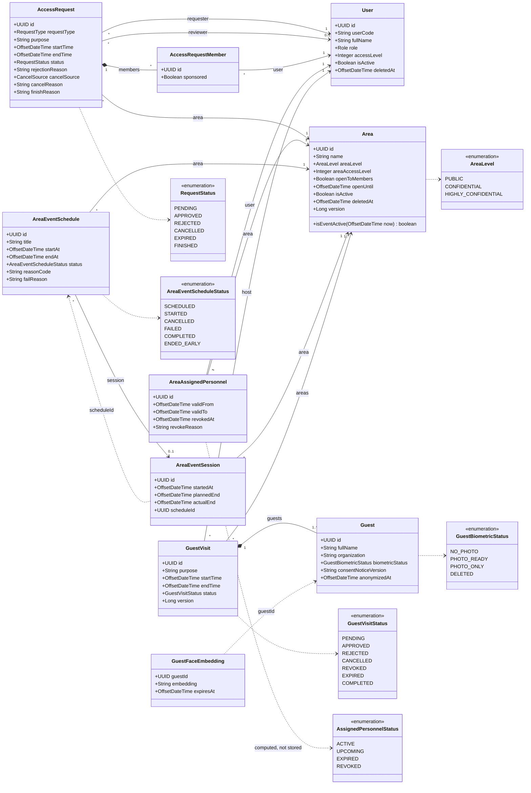

### CD-01 Access control classes, part 2 of 2: controllers, services, jobs

Source file: [`class-access-control-services.mmd`](class-access-control-services.mmd)

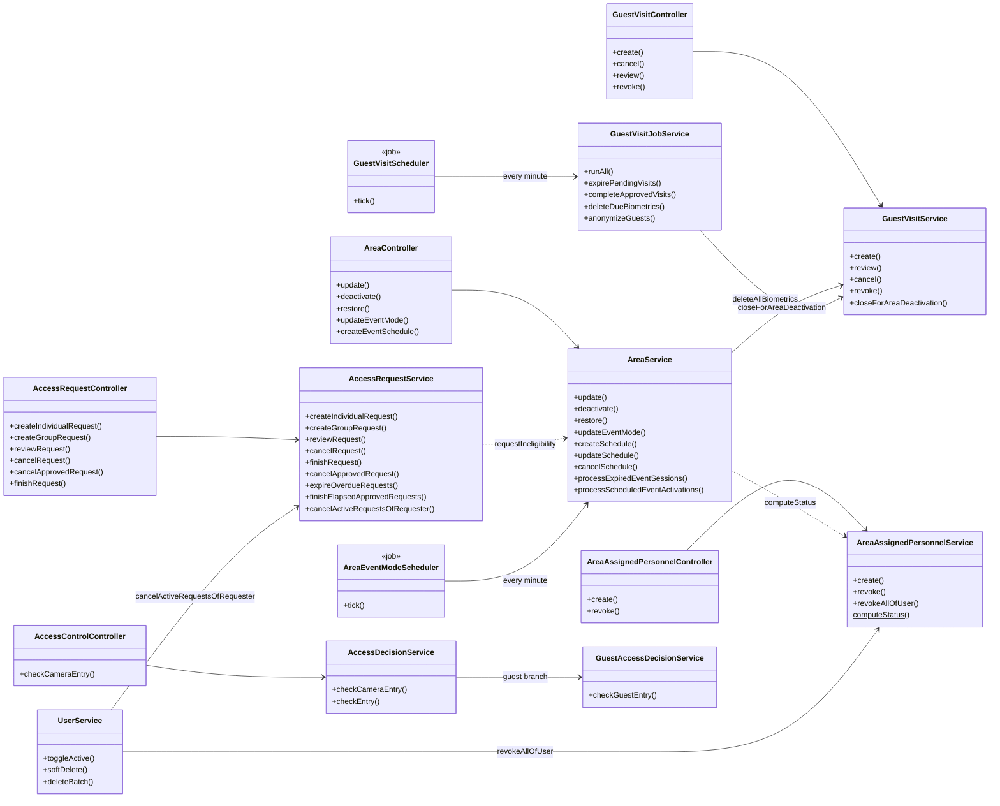

### ER-01 Access control tables

Source file: [`erd-access-control.mmd`](erd-access-control.mmd)

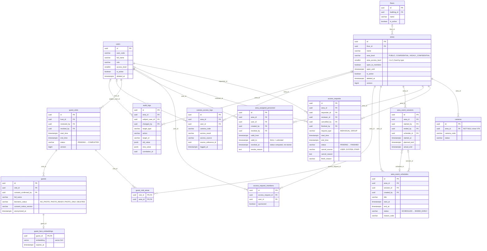
